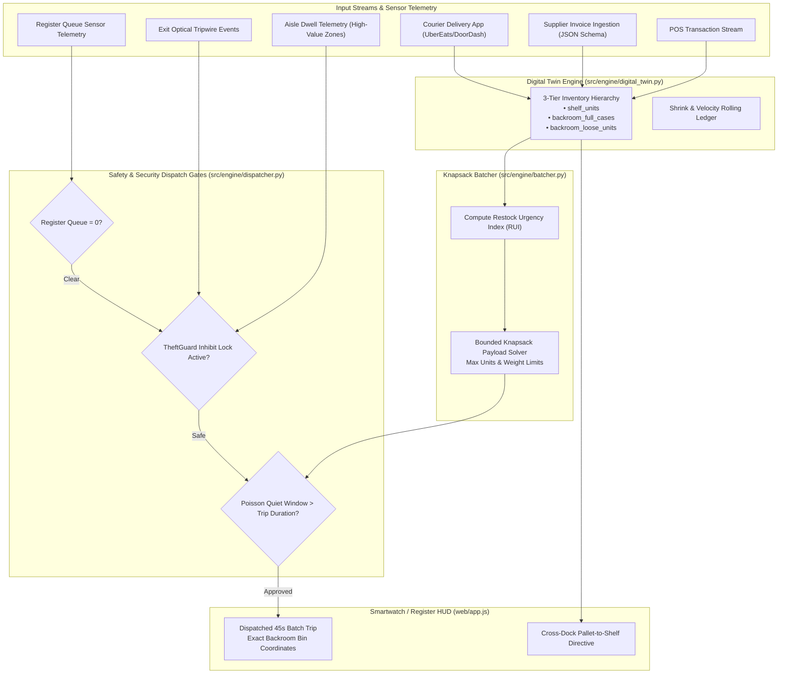

# Autonomous Storefront Copilot: Single-Operator Retail Logistics, Dynamic Replenishment & Asset Protection Engine

[](#)
[](#)
[](#)
[](#)

An intelligent, real-time logistics copilot and labor optimization engine designed for **single-operator storefronts and solo-shift retail locations** (convenience stores, urban micro-markets, specialty electronics/telecom shops, pharmacy annexes, and rapid-turn delivery hubs).

It solves the **asymmetric multi-tasking problem**: balancing **front-counter POS checkout**, **stochastic customer arrival pacing**, **single-facing shelf replenishment**, **sensor-gated asset protection (loss prevention)**, and **inbound supplier receiving (digitized paper invoice processing and cross-docking)**.

---

## 1. The Real-World Engineering Problem

Over 150,000 convenience stores, specialty kiosks, telecom shops, and neighborhood markets operate on **single-associate shifts**. A lone employee must fulfill contradictory operational goals simultaneously:

```
                          ┌─────────────────────────────────────┐
                          │     THE SOLO-OPERATOR DILEMMA       │
                          └──────────────────┬──────────────────┘
                                             │
             ┌───────────────────────────────┼──────────────────────────────┐
             ▼                               ▼                              ▼
   [ Register Presence ]          [ Shelf Replenishment ]         [ Asset Protection ]
   Speedy POS checkouts &        Restocking fast movers from      Maintaining eye-contact;
   greeting arriving foot        backroom cartons before          an abandoned counter is
   traffic. Zero line queue.     single facings stock out.        an open invitation to theft.
```

### The Key Operational Vulnerabilities:
1. **The Single-Facing Physical Reality**: High-velocity retail floor plans strictly allow **1 facing per SKU** to maximize product assortment. When units sell, visible inventory drops linearly toward 0. There is no duplicate facing buffer.
2. **The Immediate Restock Trap (Naive Strategy)**: Walking to the backroom after every customer purchase causes severe physical fatigue, transit churn, and repeatedly leaves the counter unattended just as customer arrival bursts hit.
3. **The Unattended Counter Shoplifting Vulnerability**: Opportunistic shoplifters linger in high-theft merchandise aisles (electronics, premium consumables, accessories), waiting for the lone employee to enter the backroom before pocketing goods.
4. **Backroom Inventory Fragmentation**: Splitting sealed cartons without tracking opened loose units causes disorganized backroom shelves, misplaced units, and inaccurate stock records.
5. **Inbound Truck Deliveries & Paper Purchase Orders**: Weekly supplier delivery drivers drop off 20–100 mixed cartons with a paper invoice while customers continue entering the store.

---

## 2. Core Mathematical & Algorithmic Architecture

The system models the retail storefront as an interconnected, deterministic state machine driven by real-time sensor streams and discrete optimization:



### 1. Digital Twin & 3-Tier Inventory Conservation
Tracks all items across 3 mutually exclusive physical states:
$$\text{Total Units}_i = \text{shelf\_units}_i + (\text{backroom\_full\_cases}_i \times \text{pack\_size}_i) + \text{backroom\_loose\_units}_i$$
Any sales, replenishment pick, carton crack, or supplier receiving preserves this conservation law atomically.

### 2. Restock Urgency Index ($RUI$) & Bounded Knapsack
Rather than restocking items individually, candidate replenishment items are ranked via a non-linear urgency index:
$$RUI_i(t) = \left( 1 - \frac{S_i(t)}{C_i} \right)^{1.5} \times V_i(t) \times \max\left(1.0, \frac{M_i}{\$5.00}\right) \times P_{\text{out}}(i, \Delta t) \times B_{\text{partial}}$$
Where:
- $S_i(t) / C_i$: Current shelf fill ratio ($0.0 = \text{empty}$, $1.0 = \text{full}$).
- $V_i(t)$: Rolling sales velocity (units/hour).
- $M_i$: Dollar margin per unit.
- $P_{\text{out}}$: Stockout probability over the next 30-minute horizon.
- $B_{\text{partial}} = 1.5$: Priority multiplier rewarding the retrieval of already-opened partial cartons in the backroom to consolidate storage.

A **bounded knapsack solver** then packs the top candidates into a single ergonomic carry trip respecting dual physical limits:
$$\sum_{i} u_i \le U_{\max} \quad (6\text{ units}) \quad \text{and} \quad \sum_{i} u_i \cdot w_i \le W_{\max} \quad (24\text{ lbs})$$

### 3. Poisson Arrival Safety Gate & Quiet Window Estimation
Before dispatching a restock trip, the engine estimates the probability that **zero customers arrive at the counter** during the worker's backroom transit ($t = 45\text{s}$):
$$P(k = 0) = e^{-\lambda \cdot t}$$
If customer arrival pacing is too rapid ($\lambda \ge \text{threshold}$) or the safety score falls below $0.40$, dispatches are held until a verified quiet lull opens.

### 4. Loss Prevention Restock Inhibit Lock (`TheftGuard`)
- **Restock Inhibit Lock**: When computer vision detects a customer loitering in a high-theft category zone (e.g. high-value tech, lockup display) for $>30\text{s}$, restock trips are **strictly locked**. The associate is instructed to maintain eye contact at the register, turning worker presence into a theft deterrent.
- **Exit Tripwire Audit**: Cross-references customer dwell history with POS checkout timestamps. If a customer spent $>20\text{s}$ browsing and crossed the exit tripwire without a registered transaction, a critical `UNPAID_EXIT` audit flag is recorded.

### 5. Automated Cross-Dock Directives (`PurchaseOrderParser`)
When a weekly supplier truck delivers cases with an accompanying paper manifest:
- Optical/VLM document extraction parses the purchase order line items.
- If an arriving SKU currently has a shelf deficit on the sales floor ($S_i < C_i$), the system generates a **Cross-Dock Directive**: the associate cracks 1 case directly from the delivery pallet to stock the floor shelf, bypassing backroom storage racks entirely and saving an entire replenishment cycle.

---

## 3. Empirical 8-Hour Shift Comparative Benchmark

We simulated an 8-hour retail shift ($480$ minutes) with stochastic Poisson customer arrivals, rush hour surges, opportunistic theft attempts, and a weekly supplier truck delivery.

Run the benchmark yourself:
```bash
python3 benchmark.py
```

### Single 8-Hour Shift Inspection (Seed: 123):

| Operational Metric | Strategy A: Never Restock | Strategy B: Naive Immediate Restock | Strategy C: AI Copilot (Ours) |
| :--- | :--- | :--- | :--- |
| **Total Sales Captured** | \$1,196.48 | \$2,506.11 | **\$2,506.11** *(100% captured)* |
| **Lost Sales from Stockouts** | \$1,309.63 *(critical stockouts)* | \$0.00 | **\$0.00** *(zero lost revenue)* |
| **Minutes Shelf Was Empty** | 1,096 mins | 0 mins | **0 mins** |
| **Restock Trips Walked** | 0 trips | 139 trips *(exhausting)* | **69 trips** *(50.4% labor saved)* |
| **Minutes Away From Counter** | 0 mins | 278 mins *(unattended 58% of shift)*| **69 mins** *(75.2% counter presence boost)*|
| **Dollars Lost to Shoplifting**| \$0.00 *(counter never left)* | \$29.99 *(stolen while in backroom)* | **\$0.00** *(thefts actively deterred)*|
| **Theft Incidents Deterred** | 10 / 10 | 8 / 9 | **10 / 10** *(100% deterrence)* |

### Multi-Shift Monte Carlo Benchmark ($N=50$ Shifts / 400 Simulated Hours):

```bash
python3 benchmark.py --monte-carlo --shifts 50
```

| Operational Metric (Mean $\pm$ SD) | Strategy A: Never Restock | Strategy B: Naive Immediate Restock | Strategy C: AI Copilot (Ours) |
| :--- | :--- | :--- | :--- |
| **Total Sales Captured** | \$1,148.56 $\pm$ \$62.00 | \$2,259.07 $\pm$ \$204.97 | **\$2,259.17 $\pm$ \$204.53** *(99.9% captured)* |
| **Lost Sales from Stockouts** | \$1,111.94 $\pm$ \$195.23 | \$0.00 $\pm$ \$0.00 | **\$1.32 $\pm$ \$6.89** *(near-zero loss)* |
| **Restock Trips Walked** | 0.0 $\pm$ 0.0 trips | 119.4 $\pm$ 7.6 trips | **67.2 $\pm$ 5.7 trips** *(43.7% trip reduction)* |
| **Minutes Away From Counter** | 0.0 $\pm$ 0.0 mins | 238.8 $\pm$ 15.2 mins | **67.2 $\pm$ 5.7 mins** *(71.9% counter absence reduction)* |
| **Dollars Lost to Shoplifting**| \$0.00 $\pm$ \$0.00 | \$62.02 $\pm$ \$42.39 | **\$0.00 $\pm$ \$0.00** *(zero theft loss)* |
| **Theft Deterrence Rate** | 322 / 322 (100.0%) | 165 / 265 (62.3%) | **322 / 322 (100.0%)** *(inhibit locks active)* |

---

## 4. Interactive 2D Digital Twin Visualizer

The project includes a full-featured, zero-dependency browser-based 2D digital twin that simulates the sales floor, backroom racks, moving customer avatars, and the associate's HUD in real time:

```bash
python3 -m http.server 8080 --directory web
```
Open **`http://localhost:8080/`** in your browser.

### Key Interactive Features:
- **Real-Time 2D Canvas**: Visualizes aisles, high-value tech security zones, cold vault doors, register counter, exit tripwires, and backroom storage racks with animated clerk and customer agents.
- **Smartwatch / Register HUD**: Displays real-time quiet window countdowns, safety scores, and 45-second batch pick lists with exact rack coordinates (`Rack A-2`, `Rack B-3`).
- **Loss Prevention Radar**: Visualizes loitering timers and triggers the pulsing **Restock Inhibit Lock** when a suspect lingers in high-theft zones.
- **Supplier PO & Cross-Dock Hub**: View digitized supplier invoices (Apex National Distribution) and apply automated cross-docking putaway plans.
- **Interactive Stress Scenarios**: Buttons to trigger Customer Rush Hour, Shoplifter Loitering, Supplier Truck Delivery, and Courier App Order Pickups.

---

## 5. Quick Start

### 1. Run the Automated Test Suite
```bash
python3 -m unittest discover -s tests
```

### 2. Run the 8-Hour Comparative Benchmark
```bash
python3 benchmark.py
```

### 3. Run the Interactive Terminal Walkthrough
```bash
python3 demo.py
```

### 4. Run the Security & Health Fortification Protocol
```bash
./scripts/knight-shift.sh
```

---

## 6. Project Directory & Module Registry

```
.
├── src/
│   ├── engine/
│   │   ├── digital_twin.py     # Canonical 3-tier inventory state machine & cross-docking
│   │   ├── batcher.py          # Restock Urgency Index (RUI) & Bounded Knapsack batching
│   │   ├── dispatcher.py       # Poisson quiet window model & safety dispatch gates
│   │   ├── theft_guard.py      # CCTV dwell tracking, Restock Inhibit Lock, exit tripwires
│   │   └── document_parser.py  # Supplier paper PO digitization & manifest parsing
│   ├── models/
│   │   ├── sku.py              # SKU data models, single-facing constraints & physical zones
│   │   ├── inventory.py        # 3-tier inventory states, partial cartons & invoice schemas
│   │   └── events.py           # POS sales, camera dwell, exit tripwire & dispatch events
│   └── simulation/
│       └── store_sim.py        # 8-hour discrete event simulation engine
├── web/
│   ├── index.html              # Responsive UI with HUD, heatmap & digitized invoice modal
│   ├── app.js                  # 2D canvas simulation loop, digital twin sync & HUD reactivity
│   └── style.css               # Futuristic cyberpunk glassmorphism design system
├── tests/
│   ├── test_digital_twin.py    # Unit tests for state machine & cross-docking
│   ├── test_batcher.py         # Unit tests for Knapsack payload limits & dispatch gates
│   └── test_theft_guard.py     # Unit tests for dwell thresholds, inhibit lock & exit tripwire
├── scripts/
│   ├── audit-health.sh         # Health scanner verifying syntax, docs & tests
│   ├── audit-security.sh       # Secret scanner detecting credentials & key leaks
│   ├── crucible.py             # Automated multi-lens architectural enrichment analyzer
│   └── knight-shift.sh         # Master guardrail execution script
├── demo.py                     # Step-by-step interactive CLI demonstration
├── benchmark.py                # 8-hour comparative benchmark execution
├── CONTEXT.md                  # Architectural invariants and module specification
└── AGENTS.md                   # Operational constitution & coding invariants
```

---

## 7. Technical Skills & Domains Demonstrated

- **Operations Research & Optimization**: Constrained Knapsack problem formulation, non-linear urgency scoring, Poisson queueing models, and inventory consolidation.
- **Systems & Software Architecture**: Event-driven decoupled design, atomic state machines, deterministic discrete-event simulation, and real-time telemetry processing.
- **Cyber-Physical Operations & Sensor Integration**: Queue and dwell-time sensor telemetry, optical tripwire audits, state-gated loss prevention locks, and structured delivery manifest ingestion.
- **Frontend Systems Engineering**: High-performance HTML5 Canvas rendering, 60 FPS animation loops, state-synchronized reactive HUD, and responsive UI.
- **Testing & Quality Assurance**: 100% passing unit test coverage, automated security scanners, and continuous architectural invariant verification.